# Customer Shopping Behavior Analysis


An end-to-end data analytics project that takes 3,900 retail transactions from raw data to business recommendations: cleaning and feature engineering in **Python**, ten business questions answered in **PostgreSQL**, and an interactive **Power BI** dashboard.

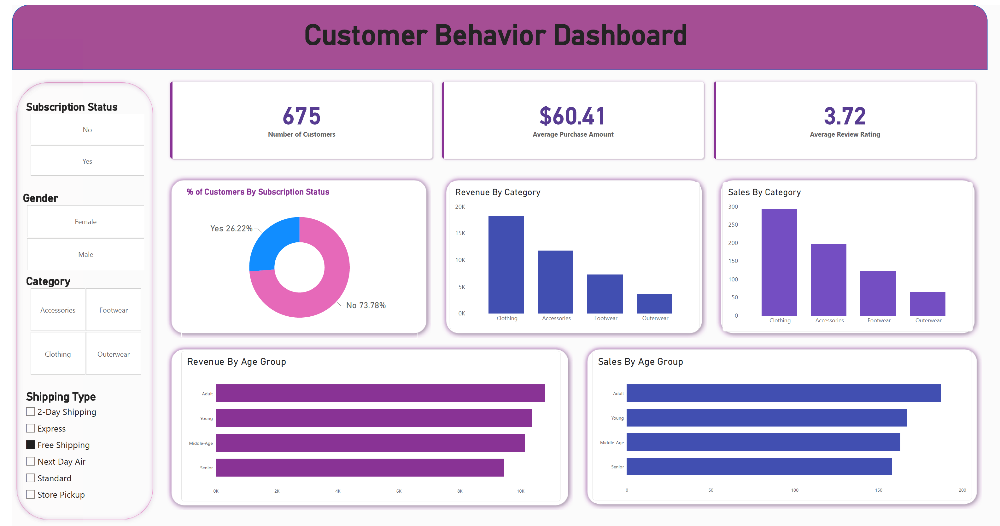

---

## Table of Contents

- [Key Results](#key-results)
- [Project Files](#project-files)
- [Project Overview](#project-overview)
- [Workflow and Tech Stack](#workflow-and-tech-stack)
- [Dataset](#dataset)
- [Step 1: Data Preparation (Python)](#step-1-data-preparation-python)
- [Step 2: Loading Data into PostgreSQL](#step-2-loading-data-into-postgresql)
- [Step 3: Business Analysis (SQL)](#step-3-business-analysis-sql)
- [Step 4: Dashboard (Power BI)](#step-4-dashboard-power-bi)
- [Insights and Recommendations](#insights-and-recommendations)
- [Limitations](#limitations)
- [Skills Demonstrated](#skills-demonstrated)

---

## Key Results

| Metric | Result |
|---|---|
| Total revenue | $233,081 across 3,900 purchases |
| Average purchase amount | $59.76 |
| Average review rating | 3.75 out of 5 |
| Revenue by gender | Male 67.7% ($157,890), Female 32.3% ($75,191) |
| Subscribers | 27% of customers (1,053), spending $59.49 per purchase vs. $59.87 for non-subscribers |
| Customer segments | Loyal 79.9%, Returning 18.0%, New 2.1% |
| Purchases using a discount | 43%, with five products discounted on 47% to 50% of purchases |
| Highest-revenue age group | Young (about 18 to 31), at 26.7% of revenue |

## Project Files

| File | Description |
|---|---|
| [Customer_Shopping_Behaviour_Analysis.ipynb](Customer_Shopping_Behaviour_Analysis.ipynb) | Jupyter Notebook with the data preparation and EDA |
| [customer_shopping_behavior.csv](customer_shopping_behavior.csv) | Dataset (3,900 rows, 18 columns) |
| [Customer_Shopping_Behavior_Analysis-Report.docx](Customer_Shopping_Behavior_Analysis-Report.docx) | Written report with findings and recommendations |
| [Customer_Behavior_Dashboard-Presentation.pdf](Customer_Behavior_Dashboard-Presentation.pdf) | Presentation slides for stakeholders |

## Project Overview

The goal is to turn raw transaction data into business insight by working through the same stages an analyst would on the job:

1. **Data preparation and EDA (Python):** clean, transform and enrich the raw dataset.
2. **Data analysis (SQL):** query the data in PostgreSQL to answer questions on customer segments, loyalty and purchase drivers.
3. **Visualization (Power BI):** build an interactive dashboard that surfaces key patterns for stakeholders.
4. **Reporting:** summarize findings and recommendations in a written report and slides.

**Business questions answered**

- Which customer groups (gender, age, subscription status) generate the most revenue?
- Do discounts, shipping type or subscriptions change how much customers spend?
- Which products are the best rated, the best selling and the most dependent on discounts?
- How loyal is the customer base, and do repeat buyers subscribe?

## Workflow and Tech Stack

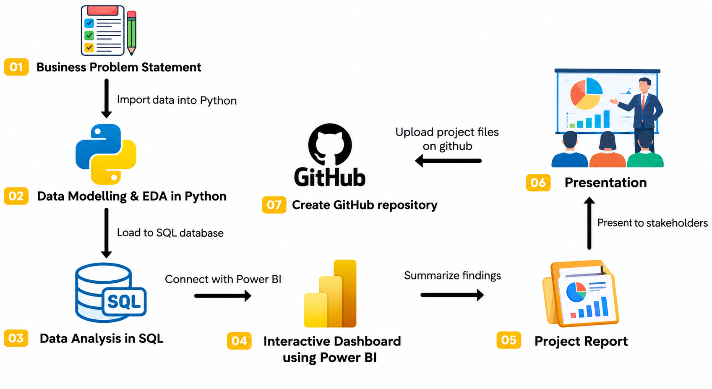

| Tool | Used for |
|---|---|
| Jupyter Notebook (Python, pandas) | Exploratory analysis, cleaning, imputation, feature engineering |
| SQLAlchemy and psycopg2 | Loading the cleaned DataFrame into PostgreSQL |
| PostgreSQL (pgAdmin 4) | Ten business analyses in SQL |
| Power BI | Interactive dashboard with DAX measures |

## Dataset

The raw data is in [customer_shopping_behavior.csv](customer_shopping_behavior.csv).

| Attribute | Detail |
|---|---|
| Rows | 3,900 purchase records |
| Columns | 18 |
| Missing data | 37 values in `Review Rating` |

| Feature group | Columns |
|---|---|
| Customer demographics | Age, Gender, Location, Subscription Status |
| Purchase details | Item Purchased, Category, Purchase Amount (USD), Season, Size, Color |
| Shopping behavior | Discount Applied, Promo Code Used, Previous Purchases, Frequency of Purchases, Review Rating, Shipping Type |
| Identifier and payment | Customer ID, Payment Method |

---

## Step 1: Data Preparation (Python)

### Initial exploration

The full code for this step is in the [Jupyter Notebook](Customer_Shopping_Behaviour_Analysis.ipynb). I started by loading the data with pandas and inspecting its structure, data types and summary statistics.

```python
df.head()
df.info()
df.describe()                 # numerical columns
df.describe(include='all')    # numerical and categorical columns
```

<details>
<summary>View exploration output</summary>

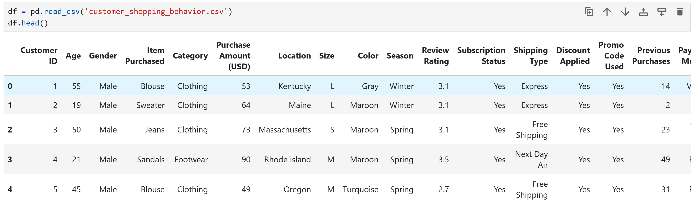
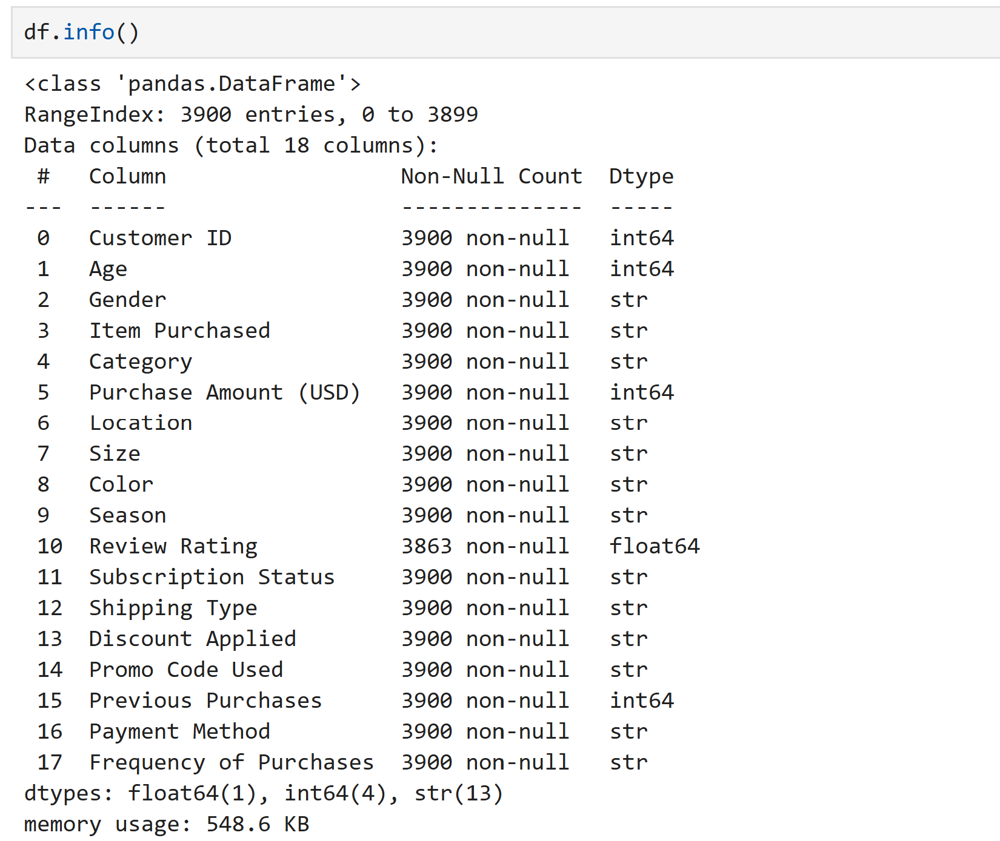
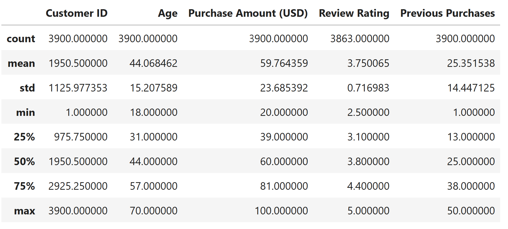
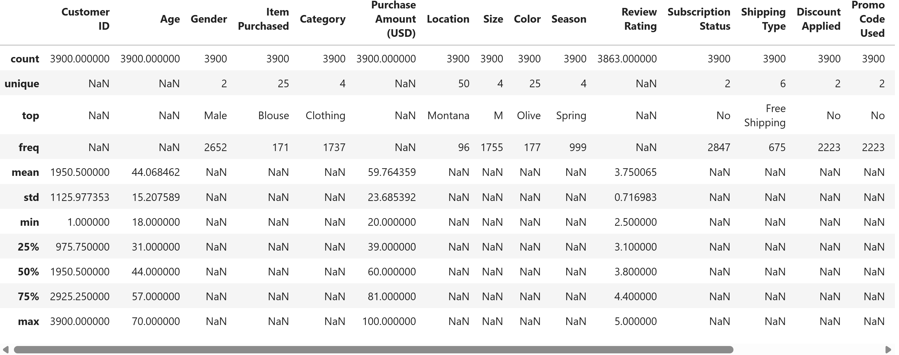

</details>

### Handling missing values

Checking for nulls showed 37 missing values in `Review Rating`.

```python
df.isnull().sum()
```

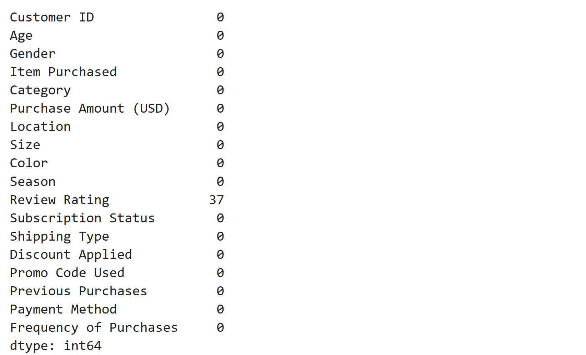

**Approach:** impute with the **median rating of each product category**. The median is preferred over the mean because it is robust to outliers, and grouping by category keeps each fill value relevant to the product type.

```python
df['Review Rating'] = df.groupby('Category')['Review Rating'].transform(
    lambda x: x.fillna(x.median())
)
```

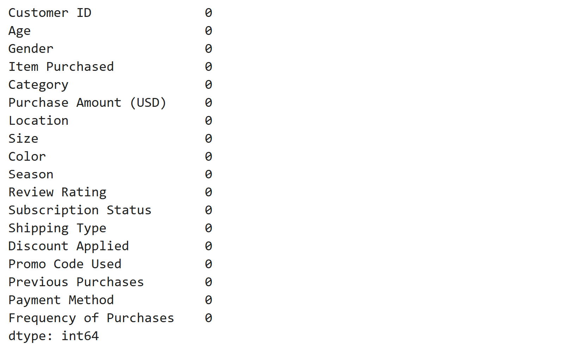

### Standardizing column names

Column names mixed upper and lower case and contained spaces, so they were converted to `snake_case`. The `purchase_amount_(usd)` column was shortened to `purchase_amount`.

```python
df.columns = df.columns.str.lower()
df.columns = df.columns.str.replace(' ', '_')
df = df.rename(columns={'purchase_amount_(usd)': 'purchase_amount'})
```

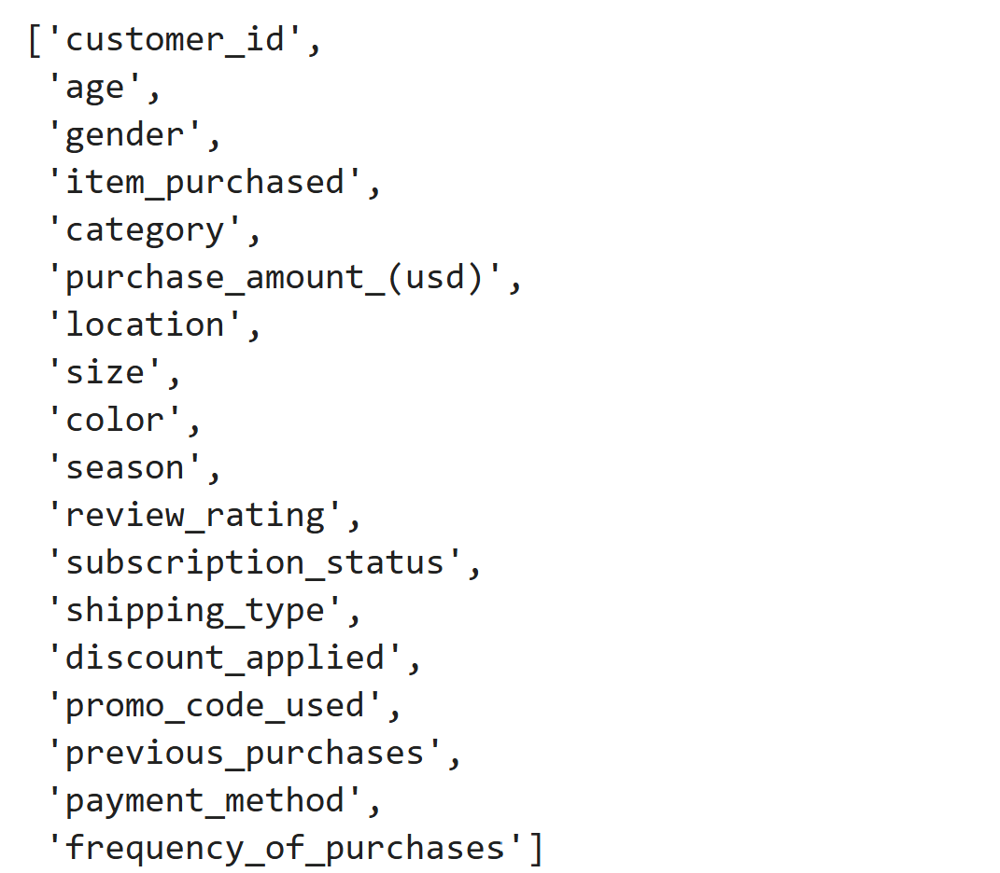

### Feature engineering

**Age groups.** Customers were split into four equal-sized groups using quartiles (`pd.qcut`).

```python
labels = ['Young', 'Adult', 'Middle-Age', 'Senior']
df['age_group'] = pd.qcut(df['age'], q=4, labels=labels)
```

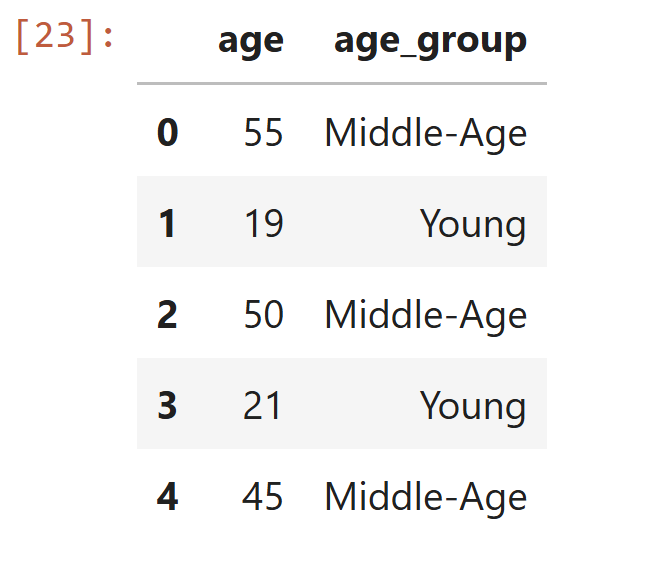

**Purchase frequency in days.** `frequency_of_purchases` is stored as text, so a numeric version was created for analysis.

```python
frequency_mapping = {
    'Fortnightly': 14,
    'Weekly': 7,
    'Annually': 365,
    'Quarterly': 90,
    'Bi-Weekly': 14,
    'Monthly': 28,
    'Every 3 Months': 90
}
df['purchase_frequency_days'] = df['frequency_of_purchases'].map(frequency_mapping)
```

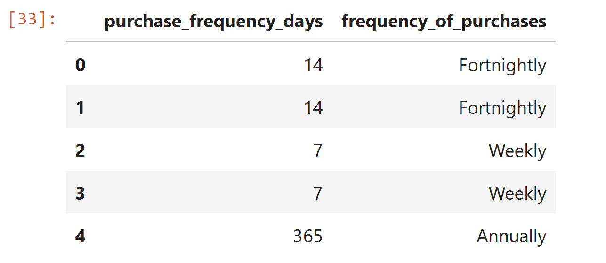

### Removing a redundant column

`discount_applied` and `promo_code_used` looked nearly identical, so I tested whether both were needed.

```python
(df['discount_applied'] == df['promo_code_used']).all()            # True
(df['discount_applied'] == df['promo_code_used']).value_counts()   # True: 3900
```

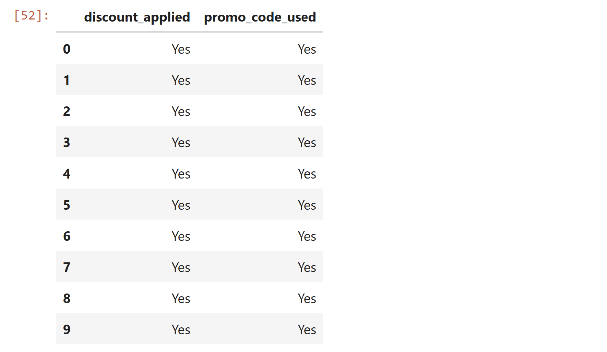

The values matched on all 3,900 rows, so `promo_code_used` was dropped.

```python
df = df.drop('promo_code_used', axis=1)
```

---

## Step 2: Loading Data into PostgreSQL

1. In **pgAdmin 4**, create a database named `customer_behavior` (**Databases > Create > Database**).

   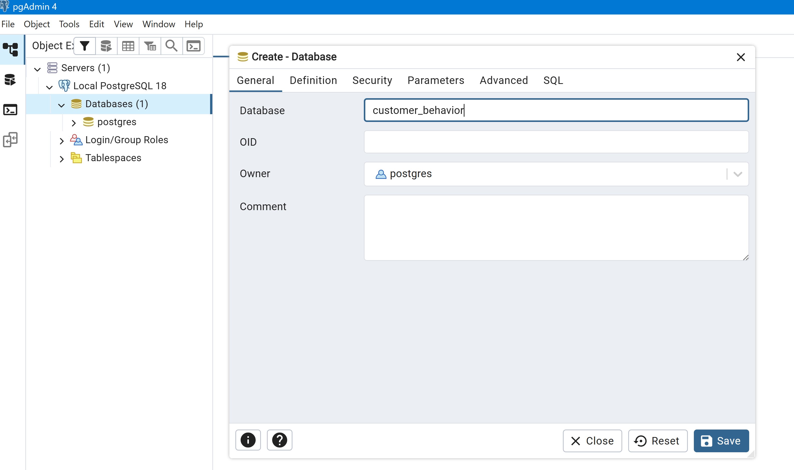

2. Install the connection libraries:

   ```bash
   pip install psycopg2-binary sqlalchemy
   ```

3. Connect from the notebook and load the cleaned DataFrame into a table named `customer`. Credentials are read from environment variables so they are never committed to the repository.

   ```python
   import os
   from sqlalchemy import create_engine

   username = os.getenv("PG_USER", "postgres")
   password = os.getenv("PG_PASSWORD")        # set in your environment
   host = os.getenv("PG_HOST", "127.0.0.1")
   port = os.getenv("PG_PORT", "5432")
   database = "customer_behavior"

   engine = create_engine(
       f"postgresql+psycopg2://{username}:{password}@{host}:{port}/{database}"
   )

   df.to_sql("customer", engine, if_exists="replace", index=False)
   print("Data successfully loaded into table 'customer' in database 'customer_behavior'.")
   ```

4. Confirm the load in pgAdmin by opening **Query Tool** on the `customer_behavior` database and running a query.

   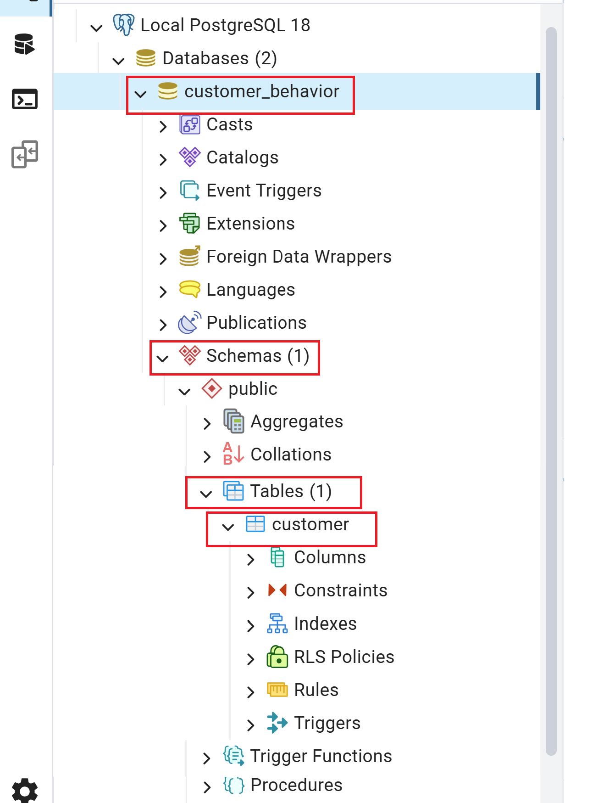
   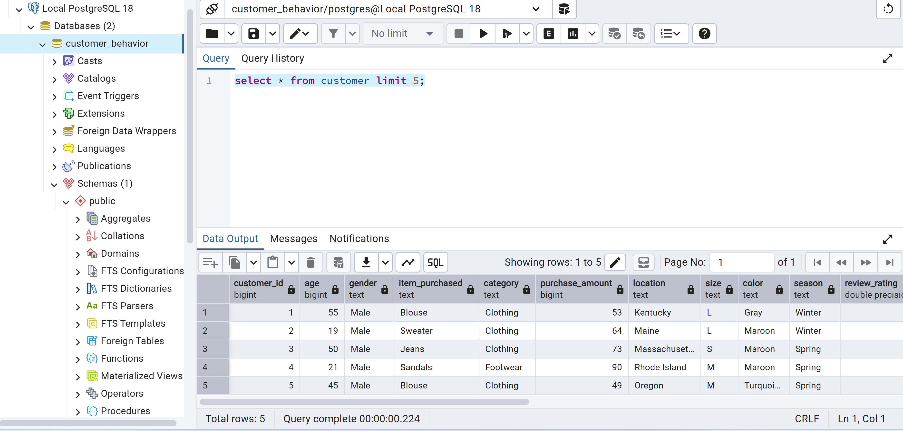

---

## Step 3: Business Analysis (SQL)

Ten business questions were answered with SQL in PostgreSQL.

### Q1. Revenue by gender

*Revenue split by gender helps design better targeted campaigns for each group.*

```sql
SELECT
    gender,
    SUM(purchase_amount) AS revenue
FROM customer
GROUP BY gender;
```

| gender | revenue |
|---|---:|
| Female | 75,191 |
| Male | 157,890 |

**Insight:** Male customers generate 67.7% of revenue. They also make up 68% of records (2,652 of 3,900), so spend per purchase is similar for both genders. The gap reflects the size of each group rather than higher individual spend.

### Q2. High spenders who used a discount

*Discounts are meant to lower spend, yet some customers still spend above average even with one.*

```sql
SELECT
    customer_id,
    purchase_amount
FROM customer
WHERE discount_applied = 'Yes'
  AND purchase_amount > (SELECT AVG(purchase_amount) FROM customer);
```

The query returns **839 customers**. The first rows:

| customer_id | purchase_amount |
|---:|---:|
| 2 | 64 |
| 3 | 73 |
| 4 | 90 |
| 7 | 85 |
| 9 | 97 |
| 12 | 68 |

**Insight:** 839 of the 1,677 customers who used a discount (about half) still spent above the $59.76 average, so discounts do not appear to cap basket size.

### Q3. Top 5 products by average review rating

```sql
SELECT
    item_purchased,
    ROUND(AVG(review_rating::numeric), 2) AS "Average Product Rating"
FROM customer
GROUP BY item_purchased
ORDER BY AVG(review_rating) DESC
LIMIT 5;
```

| item_purchased | Average Product Rating |
|---|---:|
| Gloves | 3.86 |
| Sandals | 3.84 |
| Boots | 3.82 |
| Hat | 3.80 |
| Skirt | 3.78 |

**Insight:** The top five sit in a narrow band, only about 0.1 above the overall average of 3.75, so ratings are a weak differentiator between products.

### Q4. Standard vs. Express shipping

```sql
SELECT
    shipping_type,
    ROUND(AVG(purchase_amount), 2) AS "Average Purchase Amount"
FROM customer
WHERE shipping_type IN ('Standard', 'Express')
GROUP BY shipping_type;
```

| shipping_type | Average Purchase Amount |
|---|---:|
| Express | 60.48 |
| Standard | 58.46 |

**Insight:** Express customers spend about $2.02 (3.5%) more per purchase. The difference is small and was not tested for statistical significance.

### Q5. Subscribers vs. non-subscribers

```sql
SELECT
    subscription_status,
    COUNT(customer_id) AS total_customers,
    ROUND(AVG(purchase_amount), 2) AS average_spending,
    SUM(purchase_amount) AS total_revenue
FROM customer
GROUP BY subscription_status
ORDER BY total_revenue, average_spending;
```

| subscription_status | total_customers | average_spending | total_revenue |
|---|---:|---:|---:|
| Yes | 1,053 | 59.49 | 62,645 |
| No | 2,847 | 59.87 | 170,436 |

**Insight:** Subscribers do not spend more per purchase, and only 27% of customers subscribe.

### Q6. Most discount-dependent products

```sql
SELECT
    item_purchased,
    ROUND(100.0 * SUM(CASE WHEN discount_applied = 'Yes' THEN 1 ELSE 0 END) / COUNT(*), 2) AS discount_rate
FROM customer
GROUP BY item_purchased
ORDER BY discount_rate DESC
LIMIT 5;
```

| item_purchased | discount_rate (%) |
|---|---:|
| Hat | 50.00 |
| Sneakers | 49.66 |
| Coat | 49.07 |
| Sweater | 48.17 |
| Pants | 47.37 |

> `100.0` forces decimal division. With integer `100`, PostgreSQL truncates the ratio and the rates come out as whole numbers (49.00, 48.00 and so on).

**Insight:** Across all purchases, 43% use a discount, so these five products are well above average and carry a margin risk.

### Q7. Customer segmentation

Customers are segmented by their number of previous purchases: **New** (1), **Returning** (2 to 10) and **Loyal** (more than 10).

```sql
WITH customer_type AS (
    SELECT
        customer_id,
        previous_purchases,
        CASE
            WHEN previous_purchases = 1 THEN 'New Customer'
            WHEN previous_purchases BETWEEN 2 AND 10 THEN 'Returning Customer'
            ELSE 'Loyal Customer'
        END AS customer_segment
    FROM customer
)
SELECT
    customer_segment,
    COUNT(*) AS no_of_customers
FROM customer_type
GROUP BY customer_segment;
```

| customer_segment | no_of_customers | Share |
|---|---:|---:|
| Loyal Customer | 3,116 | 79.9% |
| Returning Customer | 701 | 18.0% |
| New Customer | 83 | 2.1% |

**Insight:** The customer base is highly loyal, but very few customers are new, which suggests room to improve acquisition.

### Q8. Top 3 products in each category

```sql
WITH item_count AS (
    SELECT
        category,
        item_purchased,
        COUNT(customer_id) AS total_orders,
        ROW_NUMBER() OVER (
            PARTITION BY category
            ORDER BY COUNT(customer_id) DESC
        ) AS item_rank
    FROM customer
    GROUP BY category, item_purchased
)
SELECT
    item_rank,
    category,
    item_purchased,
    total_orders
FROM item_count
WHERE item_rank <= 3;
```

| item_rank | category | item_purchased | total_orders |
|---:|---|---|---:|
| 1 | Accessories | Jewelry | 171 |
| 2 | Accessories | Sunglasses | 161 |
| 3 | Accessories | Belt | 161 |
| 1 | Clothing | Pants | 171 |
| 2 | Clothing | Blouse | 171 |
| 3 | Clothing | Shirt | 169 |
| 1 | Footwear | Sandals | 160 |
| 2 | Footwear | Shoes | 150 |
| 3 | Footwear | Sneakers | 145 |
| 1 | Outerwear | Jacket | 163 |
| 2 | Outerwear | Coat | 161 |

> Outerwear contains only two products, so it returns two rows. Several products tie on order count (for example Pants and Blouse at 171), and `ROW_NUMBER()` breaks ties arbitrarily. Use `RANK()` if tied products should share a rank.

**Insight:** Order counts are tightly clustered within each category, so no single product dominates.

### Q9. Do repeat buyers subscribe?

Repeat buyers are customers with more than 5 previous purchases.

```sql
SELECT
    subscription_status,
    COUNT(customer_id) AS repeat_buyers
FROM customer
WHERE previous_purchases > 5
GROUP BY subscription_status;
```

| subscription_status | repeat_buyers |
|---|---:|
| No | 2,518 |
| Yes | 958 |

**Insight:** 958 of 3,476 repeat buyers (27.6%) subscribe, in line with the 27.0% rate across all customers. Buying often does not by itself make a customer more likely to subscribe.

### Q10. Revenue by age group

```sql
SELECT
    age_group,
    SUM(purchase_amount) AS revenue
FROM customer
GROUP BY age_group
ORDER BY revenue DESC;
```

| age_group | revenue | Share |
|---|---:|---:|
| Young | 62,143 | 26.7% |
| Middle-Age | 59,197 | 25.4% |
| Adult | 55,978 | 24.0% |
| Senior | 55,763 | 23.9% |

**Insight:** Age groups are quartiles (roughly equal in size), so similar revenue is expected. The Young group leads slightly, with under three percentage points between the highest and lowest groups.

---

## Step 4: Dashboard (Power BI)

### Connecting to PostgreSQL

1. Open Power BI and choose **Get Data > More > Database > PostgreSQL database > Connect**.

   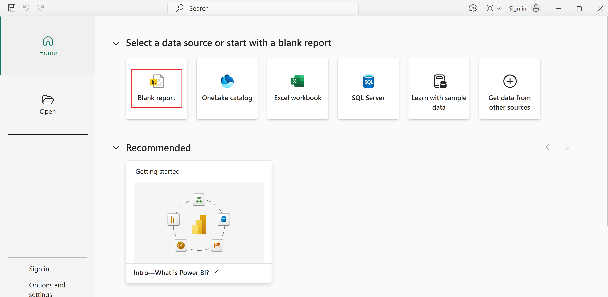
   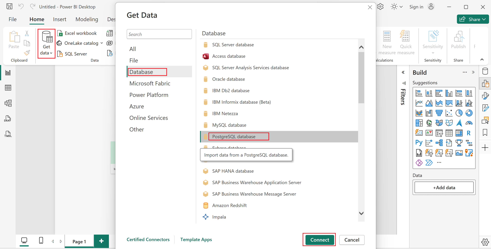

2. Enter the server `127.0.0.1:5432` and database `customer_behavior`, select **Import**, then sign in with your PostgreSQL credentials.

   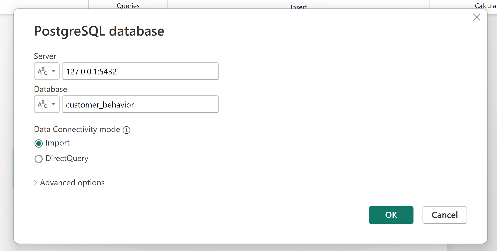
   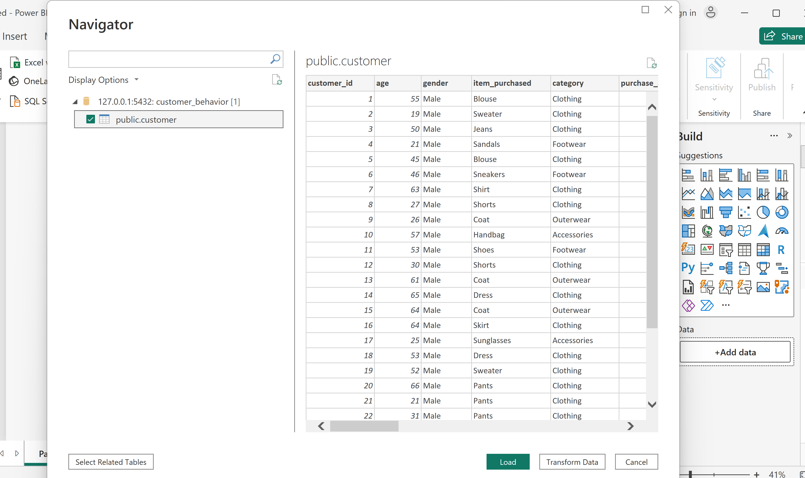

3. Confirm that the `customer` table has loaded.

   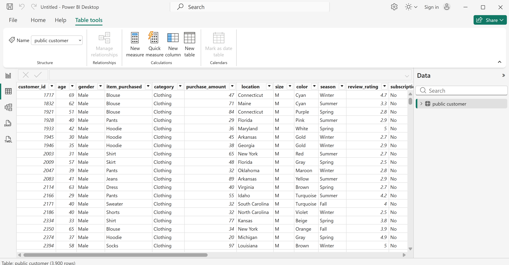

### DAX measures

```dax
Number of Customers = COUNT('public customer'[customer_id])

Average Purchase Amount = AVERAGE('public customer'[purchase_amount])

Average Review Rating = AVERAGE('public customer'[review_rating])
```

### Final dashboard


| Element | Detail |
|---|---|
| KPI cards | 3.9K customers, $59.76 average purchase amount, 3.75 average review rating |
| Charts | Customer share by subscription status; revenue and sales by category; revenue and sales by age group |
| Filters | Subscription status, gender, category and shipping type |

The dashboard is also presented in the [stakeholder presentation slides](Customer_Behavior_Dashboard-Presentation.pdf).

---

## Insights and Recommendations

The complete write-up is in the [project report](Customer_Shopping_Behavior_Analysis-Report.docx).

### Insights

- **Revenue tracks the customer mix.** Male customers make up 68% of records and 67.7% of revenue, with similar spend per purchase for both genders.
- **Subscriptions do not lift spend.** Subscribers and non-subscribers spend almost the same per purchase, only 27% of customers subscribe, and repeat buyers subscribe at the same rate as everyone else.
- **Express shipping carries a small premium** of about 3.5% on average purchase amount.
- **The base is loyal, but acquisition looks thin.** 79.9% of customers are Loyal and 2.1% are New.
- **Discounting is widespread.** 43% of purchases use a discount, and five products are discounted on 47% to 50% of purchases.
- **Clothing and Accessories lead** on both revenue and sales volume, ahead of Footwear and Outerwear.

### Recommendations

| Recommendation | Supporting evidence | Action |
|---|---|---|
| **Boost subscriptions** | Only 27% subscribe and subscribers spend no more | Promote exclusive subscriber benefits |
| **Run loyalty programs** | 18% of customers are Returning; repeat buyers do not subscribe more | Reward repeat buyers to move them into the Loyal segment |
| **Review discount policy** | 43% of purchases are discounted; five products exceed 47% | Balance sales boosts with margin control |
| **Sharpen product positioning** | Gloves, Sandals and Boots lead on rating; Jewelry, Blouse and Pants lead on orders | Feature top-rated and best-selling products in campaigns |
| **Target marketing** | Young customers generate the most revenue; Express users spend more | Focus on high-revenue age groups and express-shipping users |

## Limitations

- The dataset is a single snapshot with no date field, so trends over time cannot be assessed.
- Differences such as Express vs. Standard spend are small and were not tested for statistical significance.
- The 37 imputed review ratings use category medians, which may slightly smooth the true variation in ratings.

## Skills Demonstrated

- **Python:** data cleaning, median imputation, feature engineering and database loading with pandas and SQLAlchemy
- **SQL (PostgreSQL):** aggregation, subqueries, CTEs, window functions and conditional logic
- **Data visualization:** interactive dashboard design and DAX measures in Power BI
- **Business analysis:** turning findings into evidence-backed recommendations
